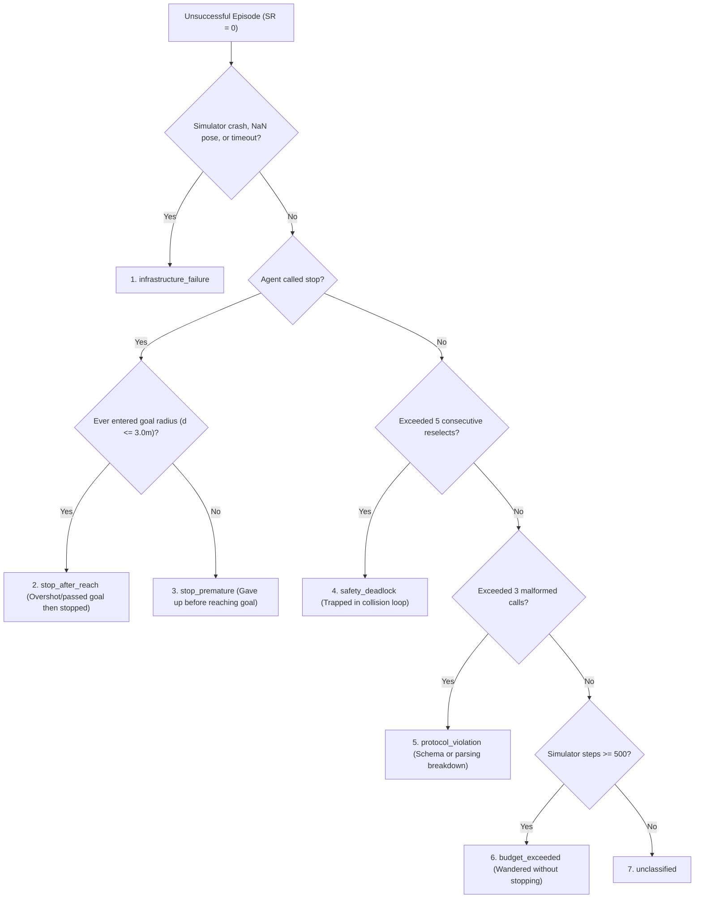

# AgenticNav: High-Level Architecture & Replication Plan

**Anchor Paper:** *AgenticNav: Zero-Shot Vision-and-Language Navigation as a Tool-Calling Harness* (arXiv:2606.10577, 2026)  
**Target Benchmark:** R2R-CE (Habitat-Sim / Matterport3D) • Standard 100 `val_unseen` episodes  
**Primary Backbone:** Gemini-3.7-Flash (Zero-Shot Function Calling)

---

## 1. Key Idea

Standard Vision-and-Language Navigation (VLN) models either train end-to-end black-box policies or treat Large Vision-Language Models (VLMs) as passive chat agents guessing continuous waypoints. **AgenticNav** recasts embodied navigation into an **active tool-calling sensory harness**:

1. **Active Perception vs. Passive Guessing**: Instead of predicting raw trajectories directly from visual frames, the VLM operates like an active explorer—querying localized 3D depth clearance and recalling historical visual observations *before* committing to physical motion.
2. **Cognition-Actuation Decoupling**: High-level semantic reasoning is assigned to an off-the-shelf multimodal model (Gemini-3.7-Flash), while spatial safety, 3D pinhole deprojection, corridor collision checking, and primitive motion execution are handled by a deterministic, zero-hallucination kinematic engine.
3. **Privilege Firewall**: The agent navigates solely from egocentric RGB observations and relative odometry. Simulator ground truth (NavMesh, shortest paths, goal coordinates, and top-down oracle maps) is strictly quarantined from the agent during execution.

---

## 2. Core Architecture & System Diagram

The framework is organized into five decoupled subsystems: **Perception**, **Spatial Memory**, **Cognition (VLM)**, **Active Tool Harness**, and **Deterministic Kinematics & Simulation**.

### 2.1 System Architecture Diagram

```mermaid
flowchart TD
    subgraph Env ["1. Physical / Simulator Environment (Habitat-Sim MP3D)"]
        SENSORS["Egocentric Sensors (RGB-D @ 640x480, 90° HFOV)"]
        ACTUATORS["Low-Level Actuators (turn_left 15°, turn_right 15°, move_forward 0.25m)"]
        ODOM["Relative Odometry (x, y, heading θ)"]
    end

    subgraph Memory ["2. Spatial Memory & State Representation"]
        BEV_GEN["Allocentric BEV Builder (Log-Odds 256x256, 0.15m/px)"]
        IMG_CACHE["Episodic Image Cache (All Visited Node RGBs)"]
        HIST_BUF["Sliding-Window Action History (Last K=6 Decisions)"]
    end

    subgraph Cognition ["3. Multimodal Cognition (Gemini-3.7-Flash)"]
        PROMPT_ENGINE["Stateless Step Prompt Rebuilder"]
        VLM{"VLM Agent (Zero-Shot Tool Calling)"}
    end

    subgraph Harness ["4. Active Tool Harness (Privilege Firewall)"]
        direction TB
        QD["query_depth(points)"]
        RC["recall(node, view)"]
        MV["move_to(view, u, v, reason)"]
        ST["stop(reason)"]
    end

    subgraph Safety ["5. Deterministic Kinematics & Safety Engine"]
        DEP["Pinhole Deprojection (u,v + z_c -> 3D Point)"]
        STANDOFF["Standoff Margin (m = 0.30m)"]
        QUANT["Discrete Primitive Quantization (15°, 0.25m)"]
        CORRIDOR{"Rectangular Corridor Check (Width 0.96m, Height 0.10-1.25m)"}
    end

    %% Data Connections
    SENSORS -->|Raw RGBs| IMG_CACHE
    SENSORS -->|Raw Depth + Odom| BEV_GEN
    ODOM --> HIST_BUF

    IMG_CACHE -->|Current 4 Views: 0°, -90°, 180°, +90°| PROMPT_ENGINE
    BEV_GEN -->|Rendered 256x256 Map with 4-View Indicators| PROMPT_ENGINE
    HIST_BUF -->|Last 6 Executed Actions & Rationales| PROMPT_ENGINE

    PROMPT_ENGINE -->|Multi-Modal Context + Tool Declarations| VLM

    %% Tool Loop Connections
    VLM -- "1. Evidence Request (<= 4/step)" --> QD & RC
    QD -->|5x5 Window Min/Mean/Med Depth| VLM
    RC -->|Cached Historical RGB| VLM

    VLM -- "2. Commit Motion" --> MV
    MV --> DEP --> STANDOFF --> QUANT --> CORRIDOR
    CORRIDOR -- "Clear" --> ACTUATORS
    CORRIDOR -- "Blocked / Out-of-Range" -->|reselect feedback| VLM

    VLM -- "3. Commit Goal Arrival" --> ST
    ST --> EVAL["Evaluation Metrics (SR, SPL, OSR, NE)"]
    ACTUATORS --> SENSORS & ODOM
```

### 2.2 Per-Step Multi-Turn Decision Loop

Each navigation decision node $t$ operates as a self-contained, multi-turn state machine:
- **Evidence Turns ($E \le 4$)**: The model may make up to $E_{\max}=4$ exploratory queries (`query_depth` or `recall`). The harness replies immediately with metric data or cached images.
- **Commit Turn**: Once satisfied, the model commits either to `move_to` or `stop`.
- **Deferred Execution**: If the model emits both an evidence call and a commit call in the same turn, the evidence call is processed while the commit call is answered as `deferred`, requiring confirmation in the subsequent turn.
- **Reselect Loop ($R \le 5$)**: If a chosen candidate target violates corridor clearance, the safety engine returns `reselect` with the exact obstacle distance, allowing the model to adjust its target.

---

## 3. Tool Calls & Implementation Details

| Tool Call | Parameters | Output Schema | Technical Implementation Details |
| :--- | :--- | :--- | :--- |
| **`query_depth`** | `points: [{view: int, u: float, v: float}]` | `{results: [{view, u, v, depth_center, depth_min, depth_mean, depth_median, status}]}` | Samples center pixel $(x_0, y_0)$ from normalized $(u,v)$ in camera view $\in \{0,1,2,3\}$. Computes summary statistics over a $5 \times 5$ window ($25$ pixels). Saturated raw values ($1.0$) or values $> 5.0\,\text{m}$ return `status: out_of_range`. Non-positive, NaN, or Inf values return `status: invalid_depth`. |
| **`recall`** | `node: int, view: int` | `{node, view, image: bytes/media_ref, status}` | Retrieves historical panoramic RGB from `EpisodicImageCache`. Enforces causal integrity: $1 \le \text{node} < t$. Requesting $\text{node} \ge t$ or non-existent nodes returns an error response; never hallucinated. |
| **`move_to`** | `view: int, u: float, v: float, reason: str` | `{status: "executed" \| "reselect", moved_m, turned_deg, primitives, reason}` | **1. Deprojection**: Pinhole unprojection $(x_c, y_c, z_c) = ((u \cdot W - c_x)\frac{z_c}{f_x}, (v \cdot H - c_y)\frac{z_c}{f_y}, z_c)$, rotated by view azimuth $\psi \in \{0^\circ, -90^\circ, 180^\circ, +90^\circ\}$.<br/>**2. Standoff**: Subtracts margin $m=0.30\,\text{m}$ from target distance: $\rho = \min(4.0, \max(0, D - m))$.<br/>**3. Quantization**: Rounds heading to $\Delta\theta = 15^\circ \times \text{round}(\theta / 15^\circ)$, distance to $\rho_q = 0.25\,\text{m} \times \lfloor \rho / 0.25\,\text{m} \rfloor$.<br/>**4. Corridor Clearance**: Validates rectangular box of width $2(r_a + m) = 0.96\,\text{m}$ and length $\rho_q + r_a$ against local 3D points in robot height band $[0.10, 1.25]\,\text{m}$. Floor ($y < 0.10\,\text{m}$) and ceiling points ($y > 1.25\,\text{m}$) are ignored. If clear, returns `executed`; if blocked, returns `reselect` with obstacle distance. |
| **`stop`** | `reason: str` | `{status: "stopped", final_node: int}` | Terminates navigation episode immediately at current coordinate. Emits terminal evaluation signal. Success requires calling `stop` within $3.0\,\text{m}$ geodesic distance to goal. |

---

## 4. Framework Data Specifications & End-to-End Dataflow

### 4.1 Data Modalities Inside the Framework

1. **Egocentric Sensory Buffers**:
   - **Panoramic RGB**: 4 perspective views at $90^\circ$ increments ($0^\circ$ Front, $-90^\circ$ Right, $180^\circ$ Back, $+90^\circ$ Left), resolution $640 \times 480$, $90^\circ$ HFOV.
   - **Metric Depth Buffers**: $640 \times 480$ metric float arrays ($\text{range} \in [0.5, 5.0]\,\text{m}$). Depth is never fed directly into prompt text; it is accessed purely via tool queries.
   - **Relative Odometry**: Delta translation and rotation $(\Delta x, \Delta y, \Delta \theta)$ tracked from episode start $(0, 0, 0)$.
2. **Internal State Representations**:
   - **Allocentric Log-Odds BEV Map**: $256 \times 256$ grid at $0.15\,\text{m/px}$ ($38.4\,\text{m} \times 38.4\,\text{m}$ span). Bayesian occupancy log-odds updates: $l_{\text{free}} = -0.405$, $l_{\text{occ}} = +0.847$. Free space is cleared along rays using Bresenham lines to obstacle hits, detected floor hits, and max-range saturated pixels. Includes 1-pixel obstacle dilation, cyan trajectory line, numbered recall badges, current red position with 4 directional FOV indicators (labeled 0, 1, 2, 3), and a 5m metric scale bar.
   - **Sliding-Window Action History**: Fixed buffer of the last $K=6$ executed decision steps, recording node transitions, primitive commands, and VLM reasoning snippets.
   - **Episodic Image Cache**: In-memory ring buffer indexed by `(node_id, view_id)` storing raw JPEG frames for zero-shot retrospective inspection.

### 4.2 End-to-End Dataflow

```
[Simulator Step Completed]
         │
         ├──► Store RGBs into EpisodicImageCache(node_t)
         ├──► Raycast Depth + Odometry into OccupancyGrid2D -> Render 256x256 BEV PNG
         └──► Append previous executed action to ActionHistory (K=6 window)
         │
[Harness Formulates Stateless Turn 0 Prompt]
         │
         ├── Context: Task Instruction + BEV Map Image + 4 Panoramic RGBs + History Text
         └── Tools Declared: query_depth, recall, move_to, stop
         │
[Gemini-3.7-Flash API Invocation] (temperature = 0.0)
         │
         ├── Case A: query_depth / recall
         │      └── Harness computes stats / fetches image ──► Returned to VLM as tool_result
         │
         ├── Case B: move_to (Corridor Blocked)
         │      └── Safety engine detects collision ──► Returned to VLM as reselect feedback
         │
         └── Case C: move_to (Corridor Safe) or stop
                ├── move_to: Translate into primitives [turn_left/right, move_forward] ──► Simulator
                └── stop: Halt episode ──► Post-hoc Evaluation Harness
```

---

## 5. Failure Handling & Guard Budgets

To guarantee that autonomous runs never hang, loop infinitely, or fail silently, the system enforces strict turn budgets and a 7-tier mutually exclusive failure waterfall:

### 5.1 Multi-Turn Guard Budgets (Per Decision Step)
- **$E_{\max} = 4$ (Evidence Query Budget)**: A maximum of 4 `query_depth` or `recall` calls are allowed per step. When $E=4$, the harness masks evidence tools and forces `move_to` or `stop`.
- **$R_{\max} = 5$ (Reselect Budget)**: If the model suggests 5 consecutive collision-blocked targets, the step aborts to prevent infinite reasoning loops.
- **$M_{\max} = 3$ (Malformed Call Budget)**: If the model emits non-tool text, invalid JSON, or undeclared tool signatures 3 times consecutively, the episode halts.
- **$A_{\max} = 500$ (Episode Action Budget)**: Hard ceiling on total low-level simulator steps.

### 5.2 7-Tier Mutually Exclusive Failure Waterfall

Any episode ending with $\text{SR}=0$ is classified into exactly one failure tier (tested in priority order):



---

## 6. Testing, Benchmarking & Comparative Framework

### 6.1 Benchmark Environment & Datasets
- **Benchmark**: Matterport3D Continuous Environments (R2R-CE).
- **Evaluation Split**: Standard 100 `val_unseen` episodes (pinned in `data/episode_list_100.json`).
- **Measurement Granularity**: Path Length (TL), Oracle Success (OSR), and Success weighted by Path Length (SPL) are calculated using **per-step low-level primitive positions**, matching official Habitat-Sim benchmark evaluation.

### 6.2 Comparison Targets: Paper Replication Baseline
We compare our replication against the published results for **Gemini-3.7-Flash**:

| Metric | Replication Target | Operational Definition |
| :--- | :---: | :--- |
| **SR** (Success Rate) $\uparrow$ | **76.0%** | Final geodesic error $d_{\text{final}} \le 3.0\,\text{m}$ AND agent explicitly called `stop`. |
| **SPL** (Success weighted by Path Length) $\uparrow$ | **66.50%** | $\text{SR} \times \frac{L_{\text{shortest}}}{\max(L_{\text{shortest}}, L_{\text{actual}})}$. Measures navigation efficiency. |
| **OSR** (Oracle Success Rate) $\uparrow$ | **78.0%** | Reached $d \le 3.0\,\text{m}$ at *any* intermediate low-level simulator step. |
| **NE** (Navigation Error) $\downarrow$ | **3.48 m** | Geodesic distance from agent final stopping position to target goal. |
| **TL** (Trajectory Length) | ~11.0 m | Cumulative sum of physical distance traversed across all primitive actions. |

### 6.3 Secondary Ablation Testing Matrix
To verify the causal impact of individual components, we evaluate 5 ablation arms using continuous paired bootstrap difference testing ($p < 0.05$ with Holm-Bonferroni correction):

| Experimental Arm | Target OSR | Target nDTW | Target NE | Scientific Hypothesis |
| :--- | :---: | :---: | :---: | :--- |
| **Full System** | **78.0%** | **69.38%** | **3.48 m** | Complete active tool-calling harness. |
| **w/o Depth Tool** | 76.0% | 65.53% | 5.03 m | Active depth queries prevent near-field wall collisions and deadlocks. |
| **Depth $\to$ Depth Image** | 76.0% | 65.68% | 4.42 m | Querying metric point statistics beats raw visual depth frame comprehension. |
| **w/o Recall Tool** | 77.0% | 64.20% | 5.10 m | Historical view recall eliminates backtracking disorientation. |
| **w/o Action History** | — | — | — | Sliding history prevents 2-node cyclic oscillations. |
| **w/o BEV Map** | — | — | — | Allocentric BEV provides spatial loop closure (paper reports 6% SR drop). |

---

## 7. Stopping Criteria & Framework Success

To prevent infinite hyperparameter tuning and confirmation bias, we enforce a strict, pre-registered statistical stopping rule:

### 7.1 Pre-Registered Consistency Acceptance Rule (Rule a)
- **Repeated Runs**: $K = 3$ independent runs across the pinned 100 `val_unseen` episodes.
- **Per-Episode Mean**: Compute per-episode average performance across the 3 runs:
  $$\overline{S}_i = \frac{1}{K}\sum_{k=1}^K S_{i,k}, \quad \overline{\text{SPL}}_i = \frac{1}{K}\sum_{k=1}^K \text{SPL}_{i,k}$$
- **Statistical Criterion**:
  $$\text{Framework Accepted} \iff 76.0\% \in \text{CI}_{95\%}(\text{SR}) \quad \text{AND} \quad 66.50\% \in \text{CI}_{95\%}(\text{SPL})$$
  where $\text{CI}_{95\%}$ is determined via non-parametric bootstrap resampling ($B = 10,000$ iterations).

### 7.2 Zero Tuning on Test Split Policy
- **Frozen Configuration**: No prompt modification, threshold adjusting, or parameter tuning is permitted against `val_unseen`.
- **Termination of Iteration**: Once the unit test suite passes 100% and the $K=3$ benchmark execution completes, the results are accepted and locked. If the empirical CI contains the target values, the replication is declared successful; if it falls outside after verified bug-free execution, the discrepancy is documented and reported without post-hoc cherry-picking.

---

## 8. Essential Additions to the High-Level Plan

### 8.1 Privilege Firewall Contract
To prevent benchmark contamination, the codebase enforces an explicit interface boundary:

| Feature / Modality | Agent Context (Permitted) | Simulation Ground Truth (Quarantined) |
| :--- | :---: | :---: |
| **Panoramic RGB Images** | Permitted (4 views at decision nodes) | — |
| **Raw Depth Buffers** | Quarantined (accessible **only** via `query_depth`) | Direct access blocked |
| **Agent Pose / Odometry** | Permitted (relative coordinates $(x, y, \theta)$) | — |
| **Top-Down Ground-Truth Map** | **Strictly Forbidden** (violates zero-shot firewall) | Used only by evaluation harness |
| **Simulator NavMesh Queries** | **Strictly Forbidden** | Used only for shortest-path calculation |
| **Goal Coordinate $(x_g, y_g, z_g)$** | **Strictly Forbidden** | Exposed only during final distance evaluation |

### 8.2 Remote GPU Cluster Profile & Compute Strategy
The cluster environment has been probed and verified for remote execution:
- **Compute Sockets**: Dual Intel Xeon Gold 6526Y (Emerald Rapids), 32 physical cores / 64 threads. User container: 32 vCPUs.
- **Accelerators**: 2× NVIDIA L40S PCIe GPUs (48 GB GDDR6 with ECC each, 350W). Driver 595.99.02, CUDA 13.2.
- **System Memory**: 132.5 GB DDR5 RAM (~110 GB free).
- **Storage**: Fast SSD home + 4.76 TB persistent scratch drive at `/home/jovyan/scratch/`.
- **Execution Allocation**: Parallel batching of Habitat-Sim episodes across 16 CPU workers; GPU 0/1 utilized for rendering and local feature extraction if needed; Gemini API calls handled asynchronously with rate limiting.

### 8.3 6-DoF Continuous UAV Decoupling Hook
While the current replication targets ground robots (Matterport3D / LoCoBot), the architecture incorporates an abstract embodiment boundary (`BaseEmbodiment`):
- `HabitatGroundEmbodiment` handles planar kinematics ($x, y, \text{yaw}$).
- To transition to aerial drones (UAVs), a `ContinuousUAVEmbodiment` is dropped in, extending `move_to` deprojection to full 3D spatial points $(x, y, z)$, replacing the 2D corridor box with a 3D bounding cylinder/ellipsoid, and generating continuous spline waypoints without changing a single line of VLM prompt logic or tool declarations.

### 8.4 Telemetry & SFT Trajectory Dataset Exporter
Every executed turn is automatically saved to structured JSONL logs (`traces/trace_logger.py`). The logger records prompt text, high-resolution RGB frames, tool inputs/outputs, primitive sequences, and failure classifications. This produces a zero-cost Supervised Fine-Tuning (SFT) dataset suitable for training smaller open-source backbones (e.g., Gemma-2, LLaVA).
