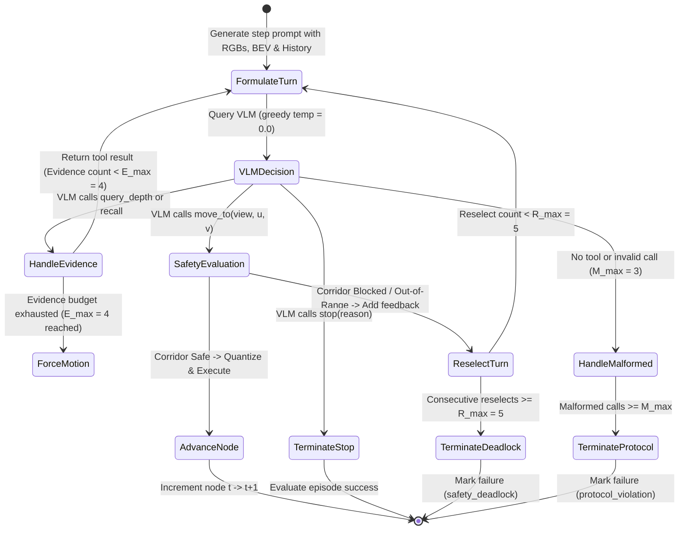
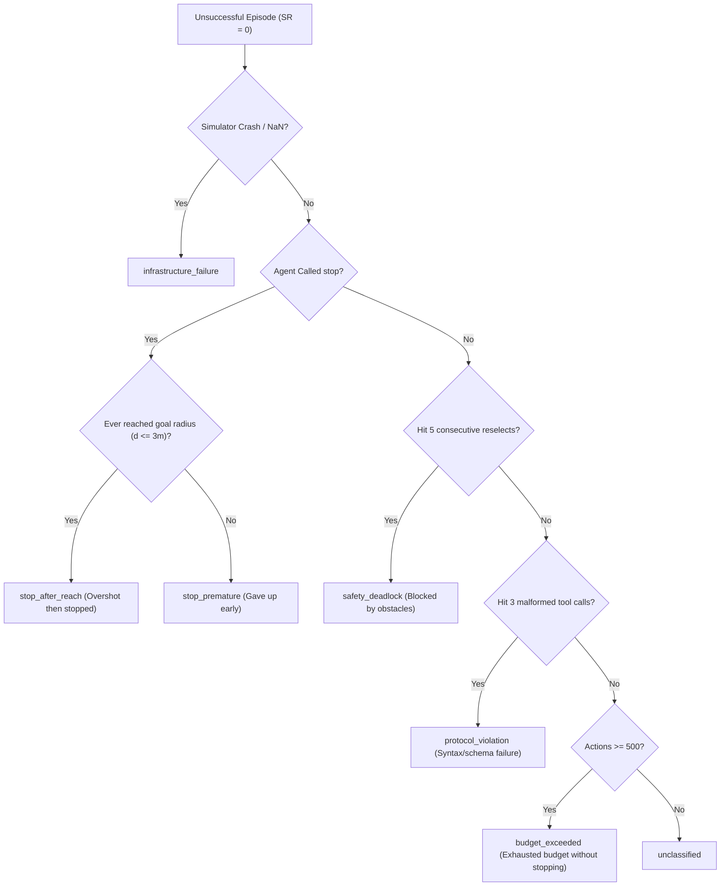

# AgenticNav: High-Level Architecture & Replication Plan

**Anchor Paper:** *AgenticNav: Zero-Shot Vision-and-Language Navigation as a Tool-Calling Harness* (arXiv:2606.10577, 2026)  
**Target Benchmark:** R2R-CE (Habitat-Sim / Matterport3D) • Standard 100 `val_unseen` episodes  
**Primary Backbone:** Gemini-3.7-Flash (Zero-Shot Tool-Calling)

---

## 1. Executive Summary & Core Concept

Standard Vision-and-Language Navigation (VLN) methods either train complex specialized neural policies or treat large models as passive chat interfaces. **AgenticNav** recasts VLN as an **active tool-calling harness**:

1. **VLM as Autonomous Planner**: The model receives multi-view panoramic RGB images, an allocentric Bird's-Eye View (BEV) map, and a short sliding-window action history.
2. **Active Perception via Tools**: The model does not passively guess paths; it actively queries 3D depth clearance and inspects historical views before committing to movement.
3. **Safety Engine & Grounding**: A deterministic kinematic harness deprojects candidate targets, quantizes continuous actions into discrete primitives, and verifies collision-free corridors against a local 3D obstacle pointcloud.
4. **Privilege Firewall**: The agent operates strictly from raw sensor data (RGB-D and odometry). Zero simulator NavMesh queries, top-down ground-truth maps, or goal coordinates are exposed during navigation.

```mermaid
flowchart TD
    subgraph Perception ["1. Multi-Modal Perception"]
        RGB["4 Panoramic Views (0° Front, -90° Right, 180° Back, +90° Left)"]
        BEV["256×256 Allocentric BEV Map (Trajectory + Nodes + 4-View Indicators)"]
        HIST["Action History (Last 6 Executed Decisions + Rationales)"]
    end

    subgraph Cognition ["2. VLM Cognition (Gemini-3.7-Flash)"]
        PROMPT["Stateless Per-Step System & User Prompt"]
        VLM{"Multi-Turn Decision"}
    end

    subgraph Tools ["3. Active Tool Harness (Privilege Firewall)"]
        QD["query_depth(points)<br/>Inspect clearance & 3D structure"]
        RC["recall(node, view)<br/>Inspect past landmark views"]
        MV["move_to(view, u, v, reason)<br/>Target selection & Corridor safety check"]
        ST["stop(reason)<br/>Declare goal arrival"]
    end

    subgraph Safety ["4. Deterministic Safety & Kinematics"]
        DEP["Deprojection & Frame Transform"]
        CORR["Corridor Collision Check (Width = 2·r_a + 2·m)"]
        QUANT["Quantize: Δθ = 15° · round(θ/15°), ρ = 0.25m · floor(ρ/0.25m)"]
    end

    subgraph Sim ["5. Simulator (Habitat-Sim / Matterport3D)"]
        PRIMS["Execute Low-Level Primitives (turn_left, turn_right, move_forward)"]
        STATE["Odometry & Raw Sensor Update"]
    end

    RGB --> PROMPT
    BEV --> PROMPT
    HIST --> PROMPT
    PROMPT --> VLM

    VLM -- "Evidence Queries (≤ E_max)" --> QD & RC
    QD & RC -- "Evidence Feedback" --> VLM

    VLM -- "Terminal Decision" --> MV & ST
    MV --> DEP --> CORR
    CORR -- "Safe" --> QUANT --> PRIMS --> STATE
    CORR -- "Blocked / Out-of-Range" -->|reselect feedback| VLM
    ST -->|Final Position| EVAL["Evaluation Metrics (SR, SPL, OSR, NE)"]
    STATE --> RGB & BEV & HIST
```

---

## 2. Core Architectural Components

### 2.1 Multi-Turn Step Decision Loop
Each decision step $t$ executes a bounded multi-turn conversation between the harness and the VLM:



#### Multi-Turn Guard Budgets:
- **Evidence Query Budget ($E_{\max} = 4$)**: Model may inspect up to 4 evidence queries per step. Once reached, motion/stop is enforced.
- **Consecutive Reselect Budget ($R_{\max} = 5$)**: Up to 5 consecutive safety rejections before the episode cleanly terminates as `safety_deadlock`.
- **Malformed Call Budget ($M_{\max} = 3$)**: Up to 3 malformed/empty tool calls before terminating as `protocol_violation`.
- **Action Prioritization**: If the model outputs both an evidence tool and a terminal tool in the same turn, the evidence tool is executed and the terminal tool is answered as `deferred`.

---

### 2.2 Active Navigation Tools

| Tool | Purpose | Key Inputs | Behavior & Output |
| :--- | :--- | :--- | :--- |
| `query_depth` | Pre-movement spatial verification | `points: [{view, u, v}]` | Returns center depth $z_c$ and $5\times 5$ window statistics (`min`, `mean`, `median`) in meters. |
| `recall` | Retrospective landmark check | `node: int`, `view: int` | Retrieves previously observed RGB view from cache ($1 \le \text{node} < t$). Enforces causal consistency. |
| `move_to` | Commit forward navigation step | `view: int`, `u: float`, `v: float`, `reason: str` | Deprojects target to 3D, checks safety corridor. Returns `executed` with primitives or `reselect` with obstacle cause. |
| `stop` | Commit goal arrival | `reason: str` | Terminates episode at current location. Evaluates success ($d_{\text{goal}} \le 3.0\,\text{m}$). |

---

### 2.3 Deterministic Kinematics & Safety Engine

The safety engine bridges continuous image space $(u, v)$ to discrete simulator actuation without simulator-level lookaheads:

1. **Pinhole Deprojection**: Image coordinates $(u, v)$ and planar depth $z_c \in [0.5\,\text{m}, 5.0\,\text{m}]$ are unprojected into the camera optical frame, rotated by view azimuth $\psi \in \{0^\circ, -90^\circ, 180^\circ, +90^\circ\}$, and transformed into the robot-centric frame ($+X$ right, $+Y$ up, $-Z$ forward).
2. **Standoff Margin**: Displacement $\rho = \min(\rho_{\max}, \max(0, D_{\text{raw}} - m))$ where $m = 0.30\,\text{m}$ prevents crashing into walls.
3. **Discrete Quantization**:
   - Heading: $\theta_q = 15^\circ \times \text{round}(\theta / 15^\circ)$
   - Distance: $\rho_q = 0.25\,\text{m} \times \lfloor \rho / 0.25\,\text{m} \rfloor$
4. **Rectangular Corridor Check**:
   - Corridor bounding box: Forward length $\rho_q + r_a$, half-width $r_a + m = 0.48\,\text{m}$ ($r_a = 0.18\,\text{m}$).
   - Tested against 3D depth pointcloud filtered to robot chassis height $[0.10\,\text{m}, 1.25\,\text{m}]$.
   - Floor points ($y < 0.10\,\text{m}$) and ceiling points ($y > 1.25\,\text{m}$) are strictly excluded.
   - If points lie inside the corridor, `reselect` is returned with exact obstacle distance.

---

### 2.4 Episodic Memory & Allocentric BEV Mapping

- **Action History (`ActionHistory`)**:
  - Sliding window of last $K=6$ executed decision steps.
  - Formats node-to-node transitions, executed primitives, and VLM rationales into the prompt.
- **Image Cache (`EpisodicImageCache`)**:
  - In-memory RGB buffer storing 4 views for all visited nodes $1 \dots t-1$.
  - Accessed causally via `recall(node, view)`.
- **Occupancy Grid & BEV Renderer (`OccupancyGrid2D`, `BEVRenderer`)**:
  - Allocentric $256 \times 256$ grid ($0.15\,\text{m/px}$, spans $38.4\,\text{m} \times 38.4\,\text{m}$).
  - Log-odds Bayesian updates: Free space clearing along rays ($l_{\text{free}} = -0.405$), obstacle cells ($l_{\text{occ}} = +0.847$).
  - Ray endpoints include obstacle points, floor hits, and saturated max-range rays ($d_{\max}$).
  - Visual layers: Trajectory polyline (cyan), numbered recall nodes (yellow), current pose (red), 4-view directional indicators labeled 0 (Front), 1 (Right), 2 (Back), 3 (Left), 1-pixel obstacle dilation, and a 5m metric scale bar.
  - Boundary-adaptive auto-recentering when the robot approaches canvas edges.

---

## 3. Strict Privilege Firewall Guarantees

To ensure strict replication integrity and prevent benchmark data contamination:

```
┌────────────────────────────────────────────────────────────────────────┐
│                        AGENT PRIVILEGE FIREWALL                        │
├───────────────────────────────────┬────────────────────────────────────┤
│ PERMITTED INPUTS (Across Firewall)│ STRICTLY FORBIDDEN (Blocked)       │
├───────────────────────────────────┼────────────────────────────────────┤
│ • 4 RGB views (Front, Right, Back,│ • Simulator NavMesh queries        │
│   Left) at decision nodes         │ • Top-down ground-truth maps       │
│ • Depth data ONLY via tool calls  │ • Target / Goal coordinates (x,y,z)│
│ • Relative odometry pose          │ • Oracle shortest paths            │
│ • Natural language instruction    │ • Geodesic distance to goal        │
│ • Self-constructed BEV & History  │ • Out-of-view obstacle locations   │
└───────────────────────────────────┴────────────────────────────────────┘
```
Oracle distances and shortest paths are queried exclusively by the external evaluation harness after an episode finishes.

---

## 4. Benchmark Targets & Statistical Acceptance Protocol

### 4.1 Target Performance (Gemini-3.7-Flash on R2R-CE `val_unseen`, 100 Episodes)
The primary benchmark goal is matching the published results:

| Metric | Target | Description |
| :--- | :---: | :--- |
| **SR** (Success Rate) $\uparrow$ | **76.0%** | Final distance to goal $d_{\text{final}} \le 3.0\,\text{m}$ AND agent called `stop` |
| **SPL** (Success weighted by Path Length) $\uparrow$ | **66.50%** | Path efficiency: $S \times \frac{L_{\text{shortest}}}{\max(L_{\text{shortest}}, L_{\text{actual}})}$ |
| **OSR** (Oracle Success Rate) $\uparrow$ | **78.0%** | Minimum distance reached at any primitive step $\le 3.0\,\text{m}$ |
| **NE** (Navigation Error) $\downarrow$ | **3.48 m** | Final geodesic distance to goal |
| **TL** (Trajectory Length) | ~11.0 m | Total distance traversed across all low-level steps |

### 4.2 Statistical Acceptance Rule (Rule a)
- **Repeated Runs**: $K = 3$ repeated evaluations over the exact 100 test episodes.
- **Episode Mean Scores**: Per-episode average $\overline{S}_i = \frac{1}{K}\sum_{k=1}^K S_{i,k}$ and $\overline{\text{SPL}}_i = \frac{1}{K}\sum_{k=1}^K \text{SPL}_{i,k}$.
- **Consistency Criterion**:
  $$\text{Pass} \iff 76.0\% \in \text{CI}_{95\%}(\text{SR}) \quad \text{AND} \quad 66.50\% \in \text{CI}_{95\%}(\text{SPL})$$
  Computed via non-parametric bootstrap ($B = 10,000$ resamples).

### 4.3 Secondary Ablation Targets & Hypotheses
Secondary ablation verification uses paired bootstrap difference testing ($p < 0.05$ with Holm-Bonferroni correction):

| Experimental Arm | Target OSR | Target nDTW | Target NE | Core Hypothesis |
| :--- | :---: | :---: | :---: | :--- |
| **Full System** | 78.0% | 69.38% | 3.48 m | Complete active harness |
| **w/o Depth Tool** | 76.0% | 65.53% | 5.03 m | Depth queries prevent near-field collisions |
| **Depth $\to$ Depth Image** | 76.0% | 65.68% | 4.42 m | Tool query format outperforms full depth frames |
| **w/o Recall Tool** | 77.0% | 64.20% | 5.10 m | Historical view recall prevents disorientation |
| **w/o Action History** | — | — | — | Sliding history enforces path progress |
| **w/o BEV Map** | — | — | — | Allocentric BEV provides spatial loop closure |

---

## 5. Strict Failure Taxonomy Waterfall

Episodes that do not achieve success are classified into mutually exclusive, non-overlapping failure categories:



---

## 6. Implementation Architecture & Code Structure

The entire reproduction codebase is structured into modular, decoupled packages:

```
agenticnav_paper_replica/
├── configs/
│   └── default_config.py         # Hardware, kinematics, budget, and ablation flags
├── geometry/
│   ├── pinhole.py                # Deprojection, extrinsics, slope, free-endpoint extraction
│   └── safety_region.py          # Quantization, standoff, corridor collision checker
├── memory/
│   ├── history.py                # Sliding-window action history formatting
│   └── image_cache.py            # Episodic RGB buffer with causal recall checks
├── mapping/
│   ├── occupancy_grid.py         # Log-odds 2D grid, raycasting, dilation, recentering
│   └── bev_renderer.py           # BEV renderer with 4-view overlay & 5m scale bar
├── harness/
│   ├── tools.py                  # Function schemas for Gemini function calling
│   ├── executor.py               # Dispatcher for query_depth, recall, move_to, stop
│   ├── step_loop.py              # Multi-turn state machine (E_max, R_max, M_max)
│   ├── prompts.py                # System instruction and stateless step prompt
│   └── runner.py                 # End-to-end single episode runner with firewall
├── embodiment/
│   ├── base.py                   # StepObservation and abstract embodiment interface
│   └── habitat_ground.py         # Production Habitat-Sim controller & Mock embodiment
├── evaluation/
│   ├── metrics.py                # VLN-CE metrics (SR, SPL, OSR, TL, NE)
│   ├── failure_classifier.py     # 7-tier failure waterfall classifier
│   └── bootstrap.py              # B=10,000 bootstrap CI & paired ablation tests
├── traces/
│   └── trace_logger.py           # Evaluation JSONL logger and SFT dataset exporter
├── vlm/
│   └── gemini_client.py          # Gemini-3.7-Flash multi-modal function calling client
├── data/
│   ├── data_loader.py            # Episode loader and synthetic episode generator
│   └── episode_list_100.json     # Pinned 100 R2R-CE val_unseen benchmark episodes
└── run_benchmark.py              # CLI benchmark runner with K-repeat aggregation
```
